# Browser visual review

All original18 baseline models and final22 records were rendered in Chromium153/software WebGL. Each was inspected in a side and three-quarter view, then in the actual product viewer. Before captures use baseline `dbe430ed2f10f7d09ef105f1b1310bc9ea3eab75`. New references have no artificial before image.

The four contact sheets below use the same camera and studio lighting. Dark-material adjustments are deliberate; no lighting change hides the geometric differences. Full-resolution PNGs, SVGs and draw/vertex/triangle metrics are retained in `visuals/before` and `visuals/after`. The original reference notes describe the inspected source images without redistributing copyrighted supplier artwork.

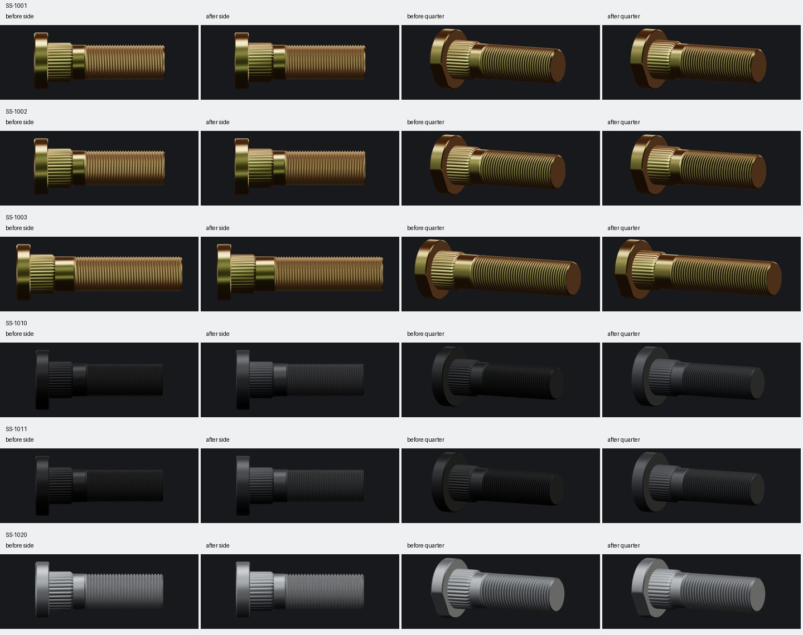

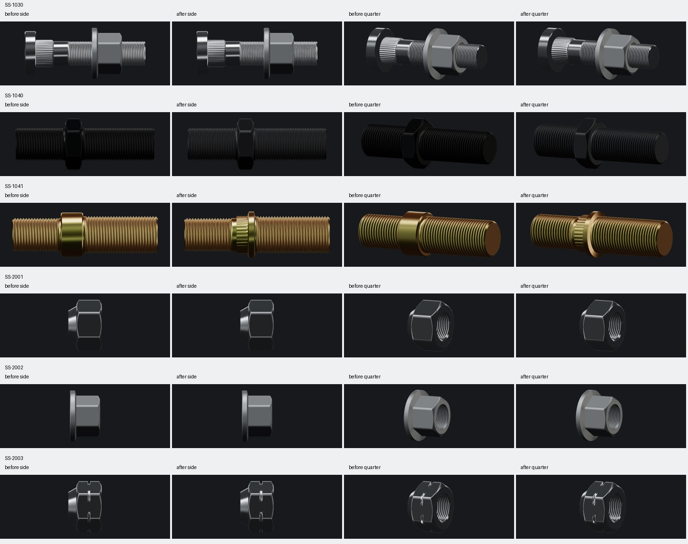

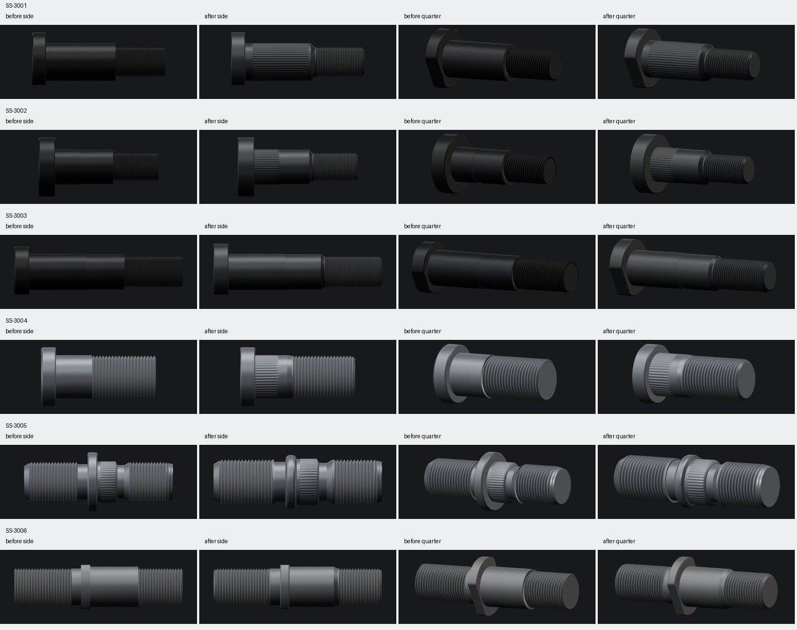

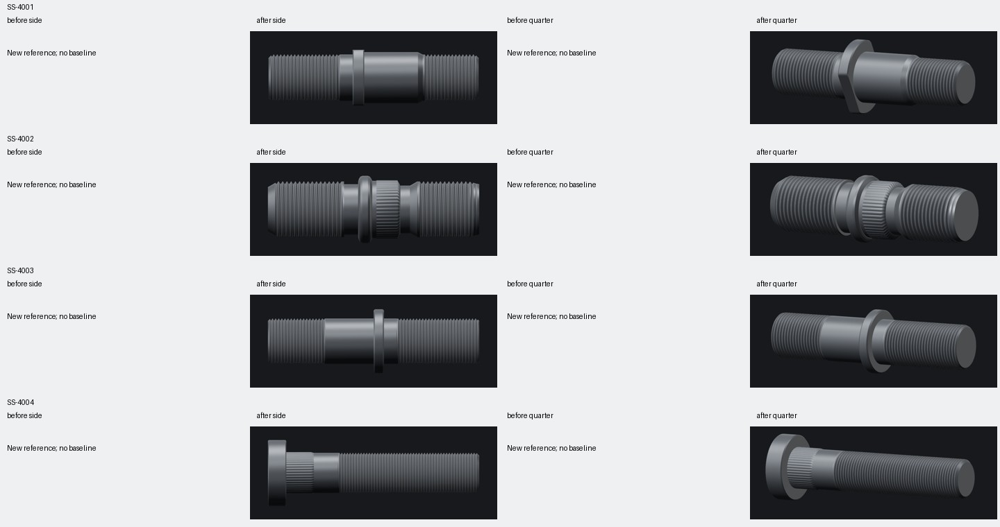

## SS-1001

**Reference / original visual notes:** Shenka headed stud photographs: shallow head, straight serrations, shoulder and threaded shaft. No exact M20 × 74 Dyna/Dutro identity. Sources: [shenka-2024](https://shenkaindustries.co.za/wp-content/uploads/2024/08/HEAVY-DUTY-TRUCK-STUDS-RANGE-Catalogue-14-AUGUST-2024_compressed.pdf).

**Review outcome:** Side: proportions retained as illustration; thread entry now eases into the shoulder. Quarter: smaller edge break and chamfered closed tip; no separate floating end ring.

| Side reconstruction | Three-quarter reconstruction |
|---|---|
| 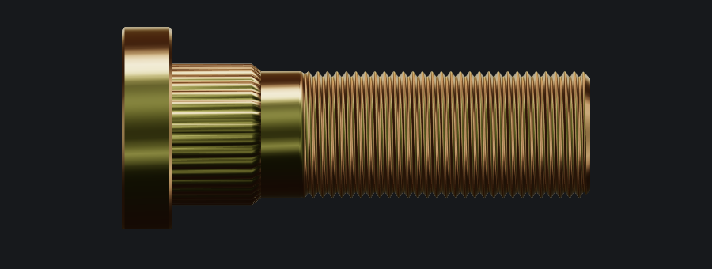 | 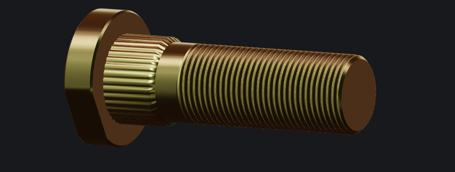 |

[Before side](visuals/before/SS-1001-side.png) · [before quarter](visuals/before/SS-1001-quarter.png) · [before browser](visuals/before/SS-1001-browser.png) · [Actual browser viewer](visuals/after/SS-1001-browser.png) · [SVG](visuals/after/SS-1001.svg)

## SS-1002

**Reference / original visual notes:** Same headed architecture as SS-1001; source does not establish this historical LH item. Sources: [shenka-2024](https://shenkaindustries.co.za/wp-content/uploads/2024/08/HEAVY-DUTY-TRUCK-STUDS-RANGE-Catalogue-14-AUGUST-2024_compressed.pdf).

**Review outcome:** Side/quarter: mirrored LH helix retained independently, with the same improved runout and tip; not assigned to a wheel side.

| Side reconstruction | Three-quarter reconstruction |
|---|---|
| 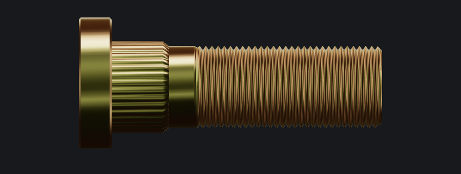 | 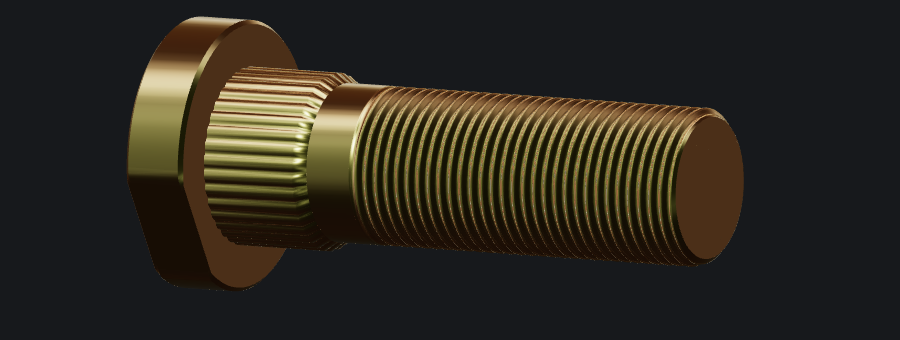 |

[Before side](visuals/before/SS-1002-side.png) · [before quarter](visuals/before/SS-1002-quarter.png) · [before browser](visuals/before/SS-1002-browser.png) · [Actual browser viewer](visuals/after/SS-1002-browser.png) · [SVG](visuals/after/SS-1002.svg)

## SS-1003

**Reference / original visual notes:** Longer headed-stud analogue; Skysun nominal47 cannot identify this 94-overall historical record. Sources: [skysun-dyna](https://skysun-truckparts.en.made-in-china.com/product/LKsQkcBYlFWh/China-10-9-Grade-Wheel-Bolt-for-Toyota-Rear-Dyna-140.html), [shenka-2024](https://shenkaindustries.co.za/wp-content/uploads/2024/08/HEAVY-DUTY-TRUCK-STUDS-RANGE-Catalogue-14-AUGUST-2024_compressed.pdf).

**Review outcome:** Side: long shoulder/thread relationship preserved. Quarter: end-cap boundary no longer depends on clamped helix rows. Not merged with short Dyna reference.

| Side reconstruction | Three-quarter reconstruction |
|---|---|
| 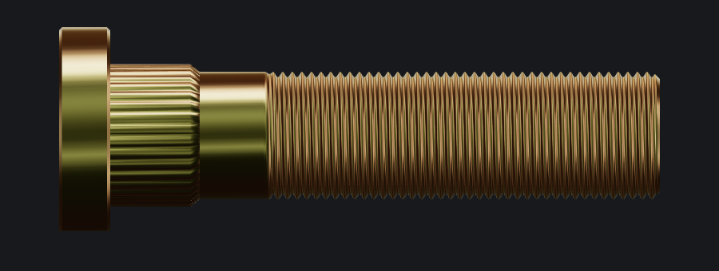 | 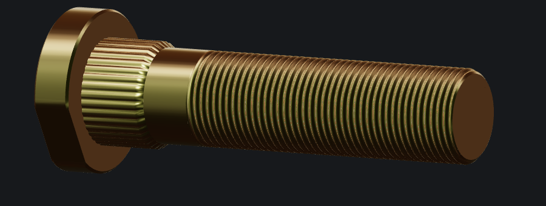 |

[Before side](visuals/before/SS-1003-side.png) · [before quarter](visuals/before/SS-1003-quarter.png) · [before browser](visuals/before/SS-1003-browser.png) · [Actual browser viewer](visuals/after/SS-1003-browser.png) · [SVG](visuals/after/SS-1003.svg)

## SS-1010

**Reference / original visual notes:** Shenka NPR examples include double-ended assemblies; they do not corroborate the original single-ended M22 × 85. Sources: [shenka-2024](https://shenkaindustries.co.za/wp-content/uploads/2024/08/HEAVY-DUTY-TRUCK-STUDS-RANGE-Catalogue-14-AUGUST-2024_compressed.pdf).

**Review outcome:** Side/quarter: original headed illustration retained, with finer spline depth and improved readable dark steel. Exact architecture remains Level D.

| Side reconstruction | Three-quarter reconstruction |
|---|---|
|  | 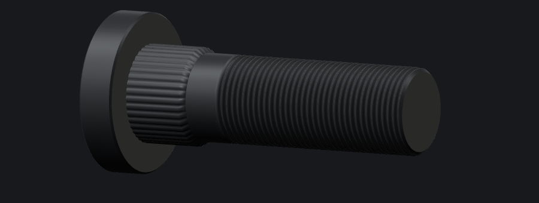 |

[Before side](visuals/before/SS-1010-side.png) · [before quarter](visuals/before/SS-1010-quarter.png) · [before browser](visuals/before/SS-1010-browser.png) · [Actual browser viewer](visuals/after/SS-1010-browser.png) · [SVG](visuals/after/SS-1010.svg)

## SS-1011

**Reference / original visual notes:** Same unresolved NPR/NQR architecture as SS-1010; no independent LH identification. Sources: [shenka-2024](https://shenkaindustries.co.za/wp-content/uploads/2024/08/HEAVY-DUTY-TRUCK-STUDS-RANGE-Catalogue-14-AUGUST-2024_compressed.pdf).

**Review outcome:** Side/quarter: same surface improvements while preserving a separate mirrored illustrative LH model. No implied real variant or fitment.

| Side reconstruction | Three-quarter reconstruction |
|---|---|
|  | 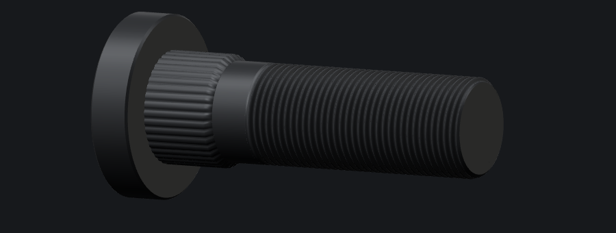 |

[Before side](visuals/before/SS-1011-side.png) · [before quarter](visuals/before/SS-1011-quarter.png) · [before browser](visuals/before/SS-1011-browser.png) · [Actual browser viewer](visuals/after/SS-1011-browser.png) · [SVG](visuals/after/SS-1011.svg)

## SS-1020

**Reference / original visual notes:** Litai Canter photo is M18/M20 × 78 double-ended; the historical headed M18 × 64 differs. Sources: [litai-canter](https://litai-autoparts.en.made-in-china.com/product/LvXEbYIVkOkZ/China-Canter-PS125-135-Wheel-Hub-Bolt-M18-1-5-M20-1-5-78-mm-Right-Side.html), [shenka-2024](https://shenkaindustries.co.za/wp-content/uploads/2024/08/HEAVY-DUTY-TRUCK-STUDS-RANGE-Catalogue-14-AUGUST-2024_compressed.pdf).

**Review outcome:** Side: retained short headed illustration. Quarter: smoother lead-in and clean cap. No false match to the photographed double-ended Canter.

| Side reconstruction | Three-quarter reconstruction |
|---|---|
| 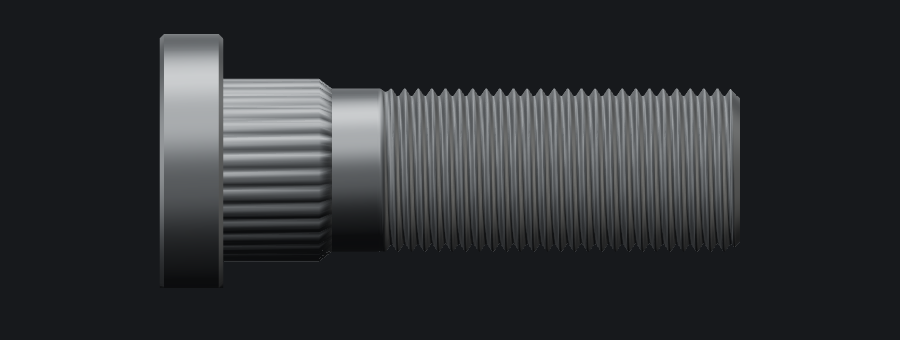 | 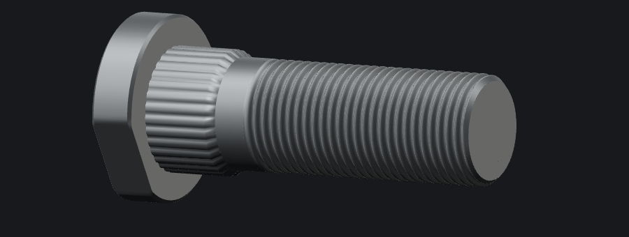 |

[Before side](visuals/before/SS-1020-side.png) · [before quarter](visuals/before/SS-1020-quarter.png) · [before browser](visuals/before/SS-1020-browser.png) · [Actual browser viewer](visuals/after/SS-1020-browser.png) · [SVG](visuals/after/SS-1020.svg)

## SS-1030

**Reference / original visual notes:** Litai GH supplier sheet shows a chamfered nut but its 33 AF × 32 dimensions differ; DT and Sanlu stud dimensions differ too. Sources: [dt-volvo](https://partnerportal.dieseltechnic.com/en/products/dt-2-65094-wheel-bolt), [sanlu-gh](https://ysbolts.en.made-in-china.com/product/bwntdGWOhlTx/China-High-Quality-Gh-Fg-Wheel-Bolt-for-Hino.html).

**Review outcome:** Side/quarter: two-material illustrative assembly has readable thread runout and nut bore. Flange remains a nut seat, not an asserted compatible washer/seat pairing.

| Side reconstruction | Three-quarter reconstruction |
|---|---|
| 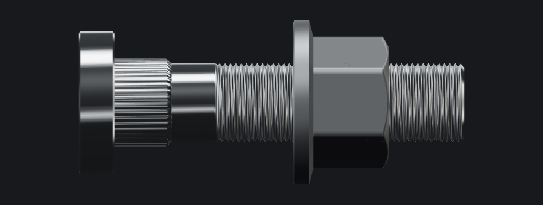 | 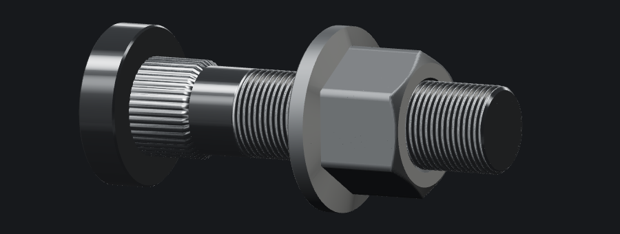 |

[Before side](visuals/before/SS-1030-side.png) · [before quarter](visuals/before/SS-1030-quarter.png) · [before browser](visuals/before/SS-1030-browser.png) · [Actual browser viewer](visuals/after/SS-1030-browser.png) · [SVG](visuals/after/SS-1030.svg)

## SS-1040

**Reference / original visual notes:** Shenka rear double-ended hardware provides only an architecture analogue; no M20 × 84 Condor match. Sources: [shenka-2024](https://shenkaindustries.co.za/wp-content/uploads/2024/08/HEAVY-DUTY-TRUCK-STUDS-RANGE-Catalogue-14-AUGUST-2024_compressed.pdf).

**Review outcome:** Side: continuous shaft/hex joins. Quarter: dark finish now exposes the hex chamfers and both threads. Illustrative centre dimensions remain unchanged.

| Side reconstruction | Three-quarter reconstruction |
|---|---|
| 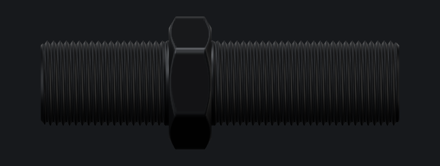 | 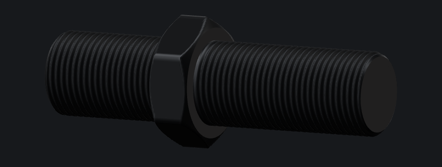 |

[Before side](visuals/before/SS-1040-side.png) · [before quarter](visuals/before/SS-1040-quarter.png) · [before browser](visuals/before/SS-1040-browser.png) · [Actual browser viewer](visuals/after/SS-1040-browser.png) · [SVG](visuals/after/SS-1040.svg)

## SS-1041

**Reference / original visual notes:** Inspected Litai Canter M18/M20 × 78 RH photo shows a short spline zone, flange and neck between unequal ends. Sources: [litai-canter](https://litai-autoparts.en.made-in-china.com/product/LvXEbYIVkOkZ/China-Canter-PS125-135-Wheel-Hub-Bolt-M18-1-5-M20-1-5-78-mm-Right-Side.html).

**Review outcome:** Side: generic large smooth collar replaced by asymmetric thread/neck/spline/flange sequence. Quarter: integral contour avoids the old ring-like silhouette. Nissan association remains unverified.

| Side reconstruction | Three-quarter reconstruction |
|---|---|
| 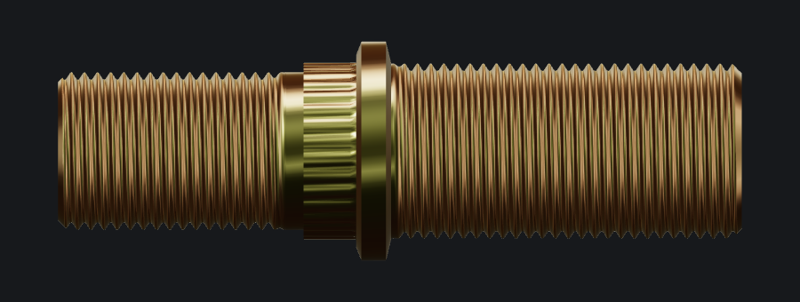 | 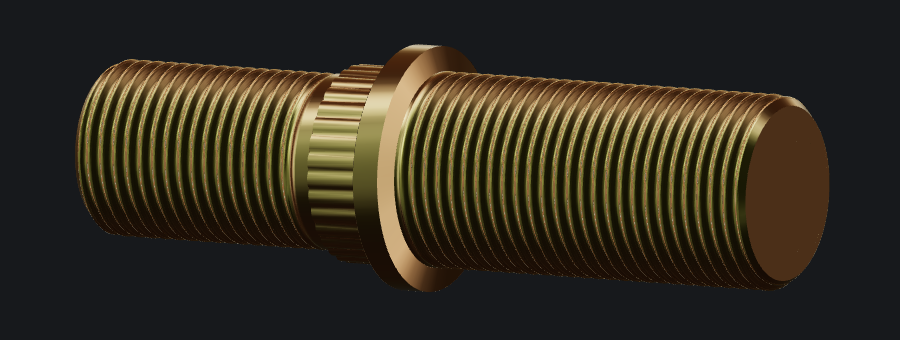 |

[Before side](visuals/before/SS-1041-side.png) · [before quarter](visuals/before/SS-1041-quarter.png) · [before browser](visuals/before/SS-1041-browser.png) · [Actual browser viewer](visuals/after/SS-1041-browser.png) · [SVG](visuals/after/SS-1041.svg)

## SS-2001

**Reference / original visual notes:** Supplier nut drawings and catalogue photos show chamfered hex bodies, internally threaded bores and distinct seat forms. Sources: litai-drawings (uploaded PDF).

**Review outcome:** Side: cone seat retained as an illustration. Quarter: continuous internal entrance and inward normals improve the bore; 32 AF/24 height not independently corroborated.

| Side reconstruction | Three-quarter reconstruction |
|---|---|
|  |  |

[Before side](visuals/before/SS-2001-side.png) · [before quarter](visuals/before/SS-2001-quarter.png) · [before browser](visuals/before/SS-2001-browser.png) · [Actual browser viewer](visuals/after/SS-2001-browser.png) · [SVG](visuals/after/SS-2001.svg)

## SS-2002

**Reference / original visual notes:** GH supplier nut is 33 AF × 32, unlike this historical 32 AF × 27 flanged illustration. Sources: litai-drawings (uploaded PDF).

**Review outcome:** Side: flange-to-hex connection retained. Quarter: internal grooves and chamfered mouth are coherent; no approval of SS-1030 pairing.

| Side reconstruction | Three-quarter reconstruction |
|---|---|
|  |  |

[Before side](visuals/before/SS-2002-side.png) · [before quarter](visuals/before/SS-2002-quarter.png) · [before browser](visuals/before/SS-2002-browser.png) · [Actual browser viewer](visuals/after/SS-2002-browser.png) · [SVG](visuals/after/SS-2002.svg)

## SS-2003

**Reference / original visual notes:** Same nut analogue; a corner groove is an illustrative LH convention, not a verified source marking. Sources: litai-drawings (uploaded PDF).

**Review outcome:** Side/quarter: separate LH bore retained, with eased groove entry replacing a sharp notch. Outer seat dimensions remain illustrative.

| Side reconstruction | Three-quarter reconstruction |
|---|---|
|  |  |

[Before side](visuals/before/SS-2003-side.png) · [before quarter](visuals/before/SS-2003-quarter.png) · [before browser](visuals/before/SS-2003-browser.png) · [Actual browser viewer](visuals/after/SS-2003-browser.png) · [SVG](visuals/after/SS-2003.svg)

## SS-3001

**Reference / original visual notes:** Drawing p1 shows D-flat head, short neck, prominent long serrated region and M18 thread. Ambiguous Ø22.8 × 1.5 × 16 callout remains in source data. Sources: litai-drawings (uploaded PDF), [shenka-2024](https://shenkaindustries.co.za/wp-content/uploads/2024/08/HEAVY-DUTY-TRUCK-STUDS-RANGE-Catalogue-14-AUGUST-2024_compressed.pdf).

**Review outcome:** Side: restored visible spline band, provisional 34.5 mm silhouette interpretation and 3 mm transition. Quarter: head/neck/spline are distinct instead of a smooth cylinder. Estimated 48 teeth are not dimension labels.

| Side reconstruction | Three-quarter reconstruction |
|---|---|
|  | 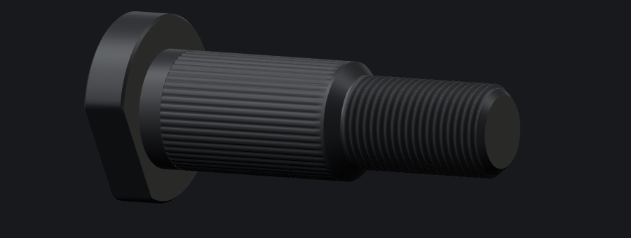 |

[Before side](visuals/before/SS-3001-side.png) · [before quarter](visuals/before/SS-3001-quarter.png) · [before browser](visuals/before/SS-3001-browser.png) · [Actual browser viewer](visuals/after/SS-3001-browser.png) · [SVG](visuals/after/SS-3001.svg)

## SS-3002

**Reference / original visual notes:** Drawing p2 shows round head, Ø22.5 knurl and stepped shoulder, but title72 conflicts with detailed66 under head. Sources: litai-drawings (uploaded PDF), [shenka-2024](https://shenkaindustries.co.za/wp-content/uploads/2024/08/HEAVY-DUTY-TRUCK-STUDS-RANGE-Catalogue-14-AUGUST-2024_compressed.pdf).

**Review outcome:** Side: short serrated zone and shoulder transition restored; provisional overall76.5 unchanged. Quarter: both machining regions are readable. No resolution of conflicting length is implied.

| Side reconstruction | Three-quarter reconstruction |
|---|---|
|  | 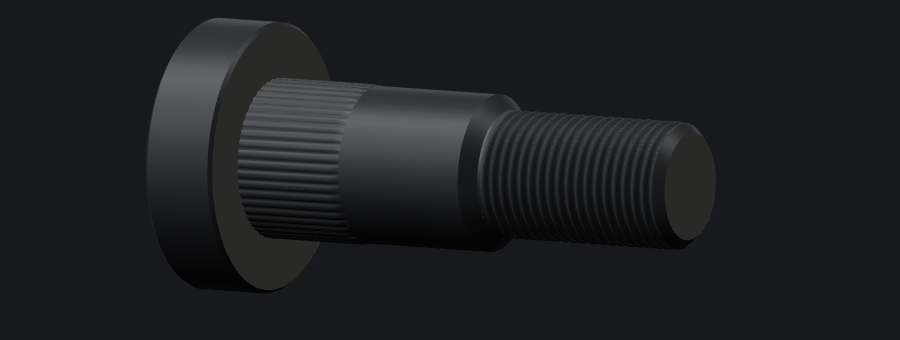 |

[Before side](visuals/before/SS-3002-side.png) · [before quarter](visuals/before/SS-3002-quarter.png) · [before browser](visuals/before/SS-3002-browser.png) · [Actual browser viewer](visuals/after/SS-3002-browser.png) · [SVG](visuals/after/SS-3002.svg)

## SS-3003

**Reference / original visual notes:** Drawing p3: R20 outer arc and centre-to-flat16 give Ø40 envelope/36 flat height; 108 under head, thread41. Sources: litai-drawings (uploaded PDF), [sanlu-gh](https://ysbolts.en.made-in-china.com/product/bwntdGWOhlTx/China-High-Quality-Gh-Fg-Wheel-Bolt-for-Hino.html).

**Review outcome:** Side: broader head envelope and tapered shoulder transition. Quarter: retained smooth Ø25.5/25 shank rather than inventing splines. The 2 mm transition is a derived display split.

| Side reconstruction | Three-quarter reconstruction |
|---|---|
|  | 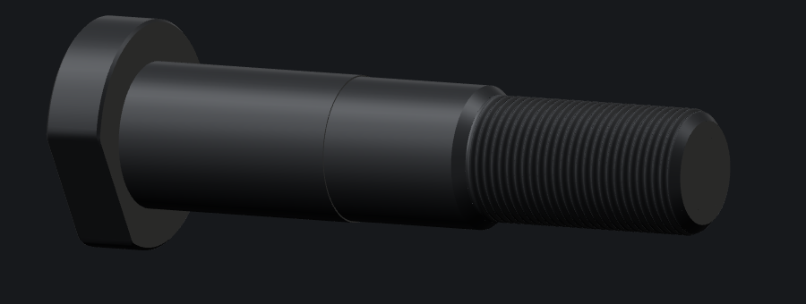 |

[Before side](visuals/before/SS-3003-side.png) · [before quarter](visuals/before/SS-3003-quarter.png) · [before browser](visuals/before/SS-3003-browser.png) · [Actual browser viewer](visuals/after/SS-3003-browser.png) · [SVG](visuals/after/SS-3003.svg)

## SS-3004

**Reference / original visual notes:** Drawing p4: short headed fastener, 47 under head, 7 head thickness and serrated 11 mm region. Head diameter not dimensioned. Sources: litai-drawings (uploaded PDF), [skysun-dyna](https://skysun-truckparts.en.made-in-china.com/product/LKsQkcBYlFWh/China-10-9-Grade-Wheel-Bolt-for-Toyota-Rear-Dyna-140.html).

**Review outcome:** Side/quarter: restores short splines and shoulder taper; estimated head Ø28 remains unlabeled. Tip chamfer removes the abrupt full-diameter end.

| Side reconstruction | Three-quarter reconstruction |
|---|---|
|  | 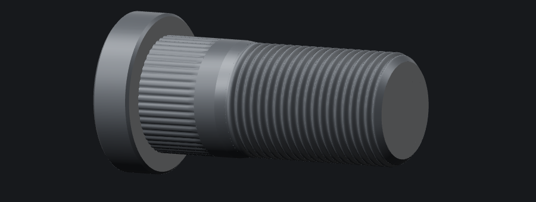 |

[Before side](visuals/before/SS-3004-side.png) · [before quarter](visuals/before/SS-3004-quarter.png) · [before browser](visuals/before/SS-3004-browser.png) · [Actual browser viewer](visuals/after/SS-3004-browser.png) · [SVG](visuals/after/SS-3004.svg)

## SS-3005

**Reference / original visual notes:** Drawing p5: 37/38 split, reduced neck, small integral flange, Z50±1 spline band and opposed M20 ends; flange diameter unknown. Sources: litai-drawings (uploaded PDF), [litai-rino](https://litai-autoparts.en.made-in-china.com/product/gGdpyeDEXTVC/China-Quanzhou-Factory-Produced-Toyota-Rino-Rear-Wheel-Hub-Bolt.html).

**Review outcome:** Side: smaller rounded flange replaces the oversized plate. Quarter: flange, 50 splines and reduced shoulder form a continuous part. Ø24 display estimate removed from both 3D and SVG measurements; min27/derived22 limits preserved.

| Side reconstruction | Three-quarter reconstruction |
|---|---|
| 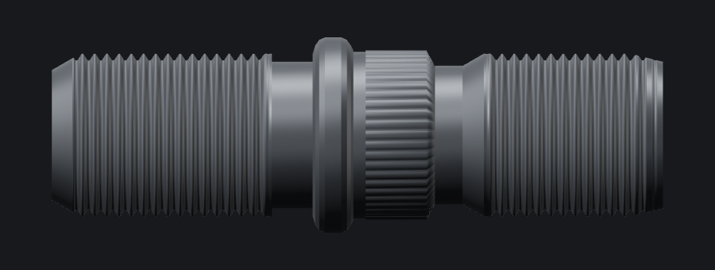 |  |

[Before side](visuals/before/SS-3005-side.png) · [before quarter](visuals/before/SS-3005-quarter.png) · [before browser](visuals/before/SS-3005-browser.png) · [Actual browser viewer](visuals/after/SS-3005-browser.png) · [SVG](visuals/after/SS-3005.svg)

## SS-3006

**Reference / original visual notes:** Drawing p6: central Ø32 drive with opposed 24±0.2 flats, unequal plain regions, thread31/24 and overall91. Sources: litai-drawings (uploaded PDF), [litai-durto](https://litai-autoparts.en.made-in-china.com/product/NneYUjLCflWS/China-Material-40cr-Durto-Hub-Bolt-M20-1-5-M20-1-5-75mm-Right-Side.html).

**Review outcome:** Side/quarter: drive stays at its actual axial station and is clipped correctly in end-view SVG. Tip chamfers replace the square ends without altering overall91.

| Side reconstruction | Three-quarter reconstruction |
|---|---|
| 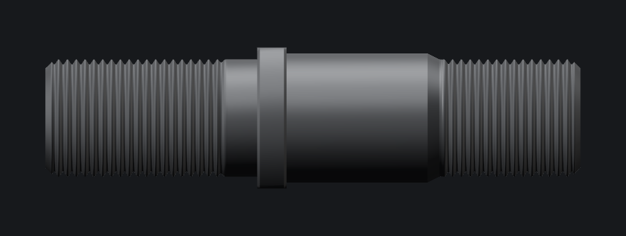 | 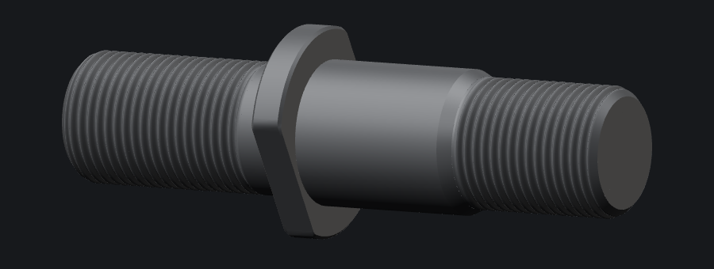 |

[Before side](visuals/before/SS-3006-side.png) · [before quarter](visuals/before/SS-3006-quarter.png) · [before browser](visuals/before/SS-3006-browser.png) · [Actual browser viewer](visuals/after/SS-3006-browser.png) · [SVG](visuals/after/SS-3006.svg)

## SS-4001

**Reference / original visual notes:** Pilot90 requirement; Durton91 drawing is only a visual analogue. Litai Durto75 listing cannot resolve identity. Sources: pilot-2026 (uploaded PDF), litai-drawings (uploaded PDF), [litai-durto](https://litai-autoparts.en.made-in-china.com/product/NneYUjLCflWS/China-Material-40cr-Durto-Hub-Bolt-M20-1-5-M20-1-5-75mm-Right-Side.html).

**Review outcome:** Side/quarter: coherent two-flat double-ended reference, all local values schematic. One plain section adjusted to depict90; no physical equality with SS-3006 asserted.

| Side reconstruction | Three-quarter reconstruction |
|---|---|
| 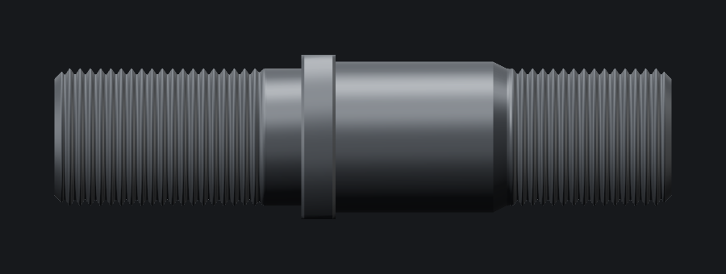 | 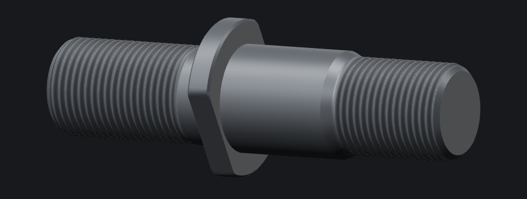 |

New reference; no baseline. [Actual browser viewer](visuals/after/SS-4001-browser.png) · [SVG](visuals/after/SS-4001.svg)

## SS-4002

**Reference / original visual notes:** Shenka 2D/DA6000 BNTHTY0003/0004 photographs establish a double-ended family; Rino drawing provides a visual analogue only. Sources: pilot-2026 (uploaded PDF), [shenka-2024](https://shenkaindustries.co.za/wp-content/uploads/2024/08/HEAVY-DUTY-TRUCK-STUDS-RANGE-Catalogue-14-AUGUST-2024_compressed.pdf), [litai-rino](https://litai-autoparts.en.made-in-china.com/product/gGdpyeDEXTVC/China-Quanzhou-Factory-Produced-Toyota-Rino-Rear-Wheel-Hub-Bolt.html).

**Review outcome:** Side/quarter: rounded flange, splines and reduced neck distinguish it from a generic threaded rod. Reused Rino proportions remain illustrative and do not establish equality.

| Side reconstruction | Three-quarter reconstruction |
|---|---|
|  | 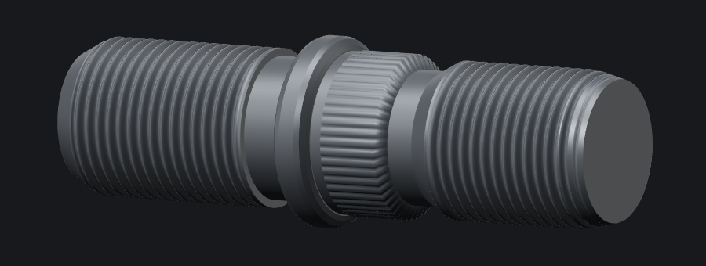 |

New reference; no baseline. [Actual browser viewer](visuals/after/SS-4002-browser.png) · [SVG](visuals/after/SS-4002.svg)

## SS-4003

**Reference / original visual notes:** Shenka CK rear photos show double-ended studs with separate nut/washer assemblies; reference hand text conflicts. Sources: pilot-2026 (uploaded PDF), [shenka-2024](https://shenkaindustries.co.za/wp-content/uploads/2024/08/HEAVY-DUTY-TRUCK-STUDS-RANGE-Catalogue-14-AUGUST-2024_compressed.pdf).

**Review outcome:** Side/quarter: stepped double-ended architecture with integrated collar. Inner thread, local lengths, assembly pairing and CK10/CK20 equivalence remain unverified; no nut is claimed.

| Side reconstruction | Three-quarter reconstruction |
|---|---|
|  | 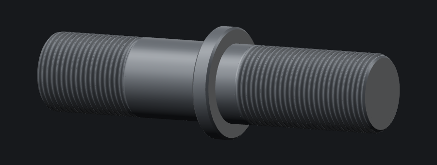 |

New reference; no baseline. [Actual browser viewer](visuals/after/SS-4003-browser.png) · [SVG](visuals/after/SS-4003.svg)

## SS-4004

**Reference / original visual notes:** DT 2.65094 table: 115 overall, 105 under head, 77 thread, Ø36 head. DT photo unavailable; comparable manufacturer headed-stud photos supply structure only. Sources: pilot-2026 (uploaded PDF), [dt-volvo](https://partnerportal.dieseltechnic.com/en/products/dt-2-65094-wheel-bolt), [alibaba-volvo](https://www.alibaba.com/product-detail/wheel-bolt-and-nut-hub-bolt_62529151291.html).

**Review outcome:** Side/quarter: long thread and shorter under-head region follow reference proportions; local spline dimensions estimated. Clear separation of requested105 and model115; LH not inferred.

| Side reconstruction | Three-quarter reconstruction |
|---|---|
| 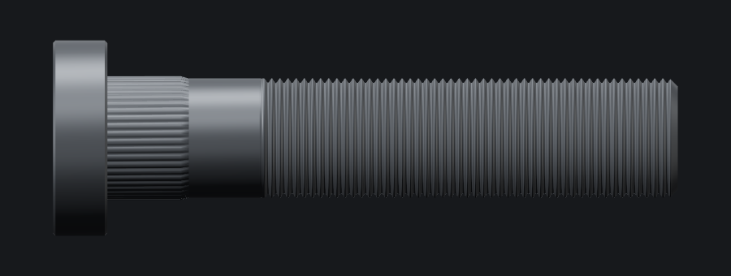 | 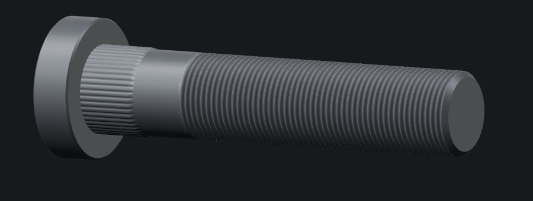 |

New reference; no baseline. [Actual browser viewer](visuals/after/SS-4004-browser.png) · [SVG](visuals/after/SS-4004.svg)

## Catalogue, mobile and print checks

- [Desktop catalogue with all22 thumbnails loaded](visuals/after/catalogue-desktop.png): each shape remains recognizable at card size; all records retain equal presentation, with data status visible.
- [390 × 844 mobile product view](visuals/after/product-mobile.png): no horizontal document overflow; viewer, drawing, details and quote controls remain accessible. Dense callouts can be toggled off using DIMS.
- [Illustrative stud/nut print sheet](visuals/after/SS-1030-spec.pdf), [Rino supplier print sheet](visuals/after/SS-3005-spec.pdf), [Volvo reference print sheet](visuals/after/SS-4004-spec.pdf): rendered with Chromium, inspected page by page. Evidence is allowed to paginate; estimated flange dimension omitted, paragraphs wrap, and closing content stays together.
- [Before metrics](visuals/before/metrics.json) and [after metrics](visuals/after/metrics.json): no final page exceptions, maximum1–2 draws per model. This does not measure real-device mobile FPS.

## Iteration notes

The first pass exposed dark phosphate details, an overly large Rino flange, absent supplier serrations and a GH head interpretation error. The second pass refined dark materials and contour joins. Browser review then caught the illustrative Ø24 flange still appearing in callouts; it is now suppressed and regression-tested. Print review caught long evidence labels wrapping into single letters and footer-only continuation pages; grid/paragraph rows, closing-block pagination and repeated page margins address those issues. No model is declared dimensionally or mechanically validated by this visual review.
